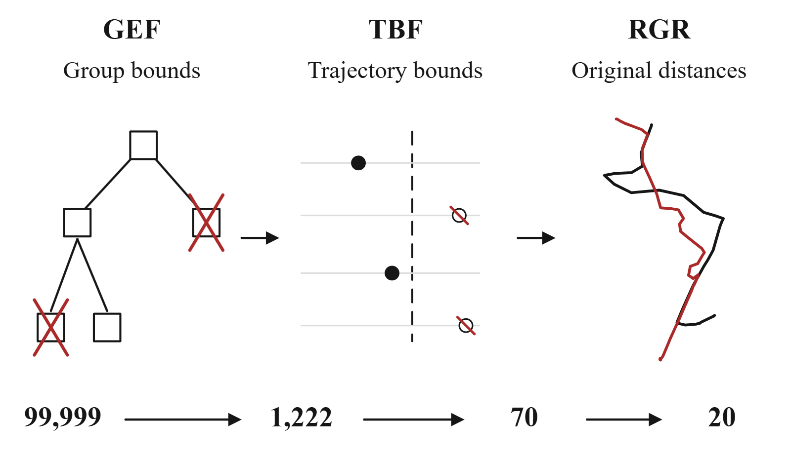

# Shared Search

[Code overview](../../README.md) / [Formula index](../../../11_docs/paper-map/README.md)

Candidate ranking provides an initialization set. Original distances to that set
establish a threshold. Full search then checks groups, individual trajectories,
and the original distances of the survivors.

The illustration is one top-20 Hausdorff query on 100K Porto.

## Search Procedure

| Paper step | Code entry |
| --- | --- |
| Load parameters and select a distance | [checkpoints.py](../checkpoints.py) |
| Cache features and original vertices | [DualFieldRetriever.encode](dual_field.py#L274), [encode_packed](dual_field.py#L283) |
| Retrieve and rank candidates | [candidate_indices](dual_field.py#L383) |
| Eq. (18), `eq:shared-threshold`: kth original distance in the initialization set, an upper bound used as the pruning threshold | [HD search_range](dual_field.py#L484), [DFD search](../dfd/dfd_range.py#L10), [DTW search](../dtw/dtw_range.py#L175) |
| Algorithm 1: group checks, trajectory checks, cached refinement, and final top-k | Same three search entries above, plus [point-set HD full](../hausdorff/pointset_index.py#L287) |
| Group Envelope Filter (GEF), Level 1 | [Group bounds by distance](#gef) |
| Trajectory Bound Filter (TBF), Level 2 | [Trajectory bounds by distance](#tbf) |
| Raw Geometry Refinement (RGR), Level 3 | [Original-distance code by distance](#rgr) |
| Reusable single-query execution | [runtime/session.py](runtime/session.py) |

## GEF

**Group Envelope Filter (Level 1).** Skip a group when its lower bound exceeds the search threshold.

| Distance | Bound | Search implementation |
| --- | --- | --- |
| Hausdorff, vertex-to-segment (100K) | [node_lower_bound](group_envelope_filter.py#L20) | [enumerate_kernel](../hausdorff/range_search.py#L17) |
| Hausdorff, point-set (SDD) | [node_bound](../hausdorff/pointset_index.py#L92) | [enumerate_kernel](../hausdorff/pointset_index.py#L182) |
| DFD | Field ranges and endpoint boxes: [make_native](../dfd/dfd_tree.py#L128) | [native_enum, group check](../dfd/dfd_tree.py#L88) |
| DTW | [dtw_node_bound_kernel](group_envelope_filter.py#L36) | [leaf_traversal](../dtw/dtw_parallel.py#L24), [enumerate_sum](../dtw/dtw_range.py#L63) |

## TBF

**Trajectory Bound Filter (Level 2).** Check each remaining trajectory's lower bound against the threshold.

| Distance | Bound and filtering code |
| --- | --- |
| Hausdorff, vertex-to-segment (100K) | [cross_field_lower_bound](trajectory_bound_filter.py#L11); [traversal check](../hausdorff/range_search.py#L46) |
| Hausdorff, point-set (SDD) | [member_bound](../hausdorff/pointset_index.py#L101), [member_keep](../hausdorff/pointset_index.py#L113) |
| DFD | [native_enum, trajectory check](../dfd/dfd_tree.py#L106) |
| DTW | [dtw_individual_bound_kernel](trajectory_bound_filter.py#L27), [check_leaf_tiles](../dtw/dtw_parallel.py#L130); [ordered block filter](../dtw/dtw_probe_intervals.py#L175) |

## RGR

**Raw Geometry Refinement (Level 3).** Evaluate original distances for surviving trajectories, reuse cached scores, and return the top-k.

| Distance | Original-distance code | Search integration |
| --- | --- | --- |
| Hausdorff, vertex-to-segment (100K) | [directed_hausdorff_squared](raw_geometry_refinement.py#L15); [bounded refinement](early_refinement.py) | [search_chunk](../hausdorff/range_search.py#L64) |
| Hausdorff, point-set (SDD) | [point_direction](raw_geometry_refinement.py#L62), [hausdorff_pair_kernel](raw_geometry_refinement.py#L82) | [full](../hausdorff/pointset_index.py#L287) |
| DFD | [original_value](../dfd/dfd_refinement.py#L22), [cached_pairs](../dfd/dfd_refinement.py#L74) | [search](../dfd/dfd_range.py#L10) |
| DTW | [bounded_kernel](../dtw/dtw_bounded.py#L18); [batch_frontier_kernel](../dtw/dtw_frontier.py#L116) | [search](../dtw/dtw_range.py#L175) |

## Symbols and Conventions

- `k` is the number of returned neighbors, `p` is the retrieved pool size, and `s` is the number of initialization candidates evaluated with the original distance. Keep `p >= s >= k`.
- The training radius uses known reference neighbors. The search threshold uses the current initialization set. They are different quantities.
- [interval_index.py](interval_index.py) implements score/ID ordering with `lex_keys`. Query IDs control self exclusion.
- [precision.py](precision.py) and [numeric.py](numeric.py) handle finite-precision policy and comparison guards. The exact-arithmetic theorem is not a claim of universal FP32/FP64 identity.
- [candidate_policy.py](candidate_policy.py), [candidate_pages.py](candidate_pages.py), and [runtime/automatic.py](runtime/automatic.py) handle budgets and execution paths as k changes.

The neighbor-inclusion and exactness results are mathematical statements about
valid bounds. Their operational checks are in [range-search tests](../../../08_tests/tests/rq2/test_range_search.py),
[precision tests](../../../08_tests/tests/rq2/test_precision.py), and
[large-k tests](../../../08_tests/tests/rq5/). Tests exercise implementations, not replace the proofs.
