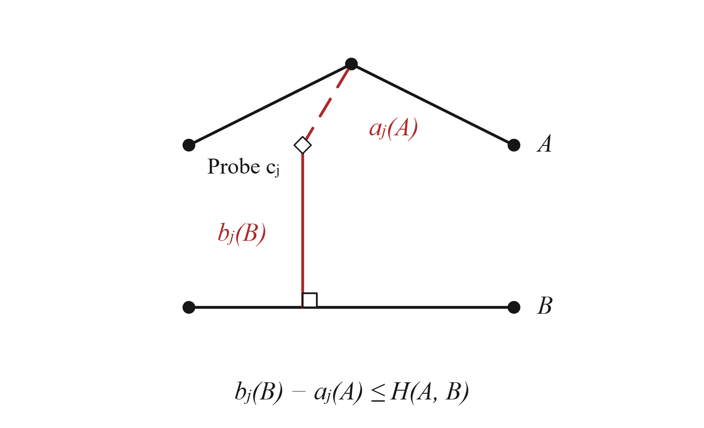

# Hausdorff

[Shared search](../common/README.md) / [Formula index](../../../11_docs/paper-map/README.md)

100K uses distances from vertices to segments. SDD uses point-set Hausdorff.
Both use the same filtering framework, with different cached fields.

Full search reuses the original distances already computed for initial
candidates when those trajectories reach final refinement. See
[cached refinement](cached_refinement.py) and the
[buffered single-request path](pointset_plan.py). Candidate budgets, bounds,
and final ranking are unchanged; no additional database fields are stored.
DFD already reuses its seed distances, and DTW excludes seeds from subsequent
refinement before merging their stored distances.

## Vertex and Segment Fields

| Paper equation | Meaning | Implementation |
| --- | --- | --- |
| (1) `eq:directed` | Largest nearest-segment distance in one direction | [directed_hausdorff_squared](../common/raw_geometry_refinement.py#L15) |
| (2) `eq:target` | Larger of the two directed distances | [hausdorff_pair_kernel](../common/raw_geometry_refinement.py#L82) |
| (5) `eq:dual-fields` | At probe `p_j^{pr}`, `a_j` is the nearest-position distance and `b_j` the nearest-segment distance | [fields_torch](../common/dual_field.py#L26), [field_kernel](../common/dual_field.py#L52) |
| (7) `eq:lower-bound` | Largest cross-field gap over probes and directions | [score_torch](../common/dual_field.py#L46), [cross_field_lower_bound](../common/trajectory_bound_filter.py#L11) |
| (9) `eq:node-bound` | Replace a member's fields by the group's extrema | [node_envelope](../common/group_envelope_filter.py#L12), [node_lower_bound](../common/group_envelope_filter.py#L20) |

Segment projection is clipped to the segment and handles zero-length segments.
Some kernels retain squared distances internally and take a square root at the
output. The original-distance definition remains Euclidean.

## Point Set Fields

For SDD, each probe stores the nearest vertex distance `a_j` and the farthest
vertex distance `f_j`. Eq. (8), `eq:pointset-bound`, takes the largest absolute
field difference over both fields and all probes.

| Operation | Implementation |
| --- | --- |
| Compute nearest/farthest fields | [field_kernel](pointset_index.py#L17) |
| Eq. (8), compare trajectories | [member_bound](pointset_index.py#L101) |
| Group ranges and distance to a range | [leaf_kernel](pointset_index.py#L66), [node_bound](pointset_index.py#L92) |
| Retrieve candidates / full search | [SearchTree](pointset_index.py#L228), [full](pointset_index.py#L287) |
| Original point-set distance | [point_direction](../common/raw_geometry_refinement.py#L62) |

[Learning and placement](../training/README.md) explains Eqs. (21) and (23).
[Point-set execution tests](../../../08_tests/tests/rq2/test_pointset_execution.py)
and [threshold-refinement tests](../../../08_tests/tests/rq2/test_hausdorff_threshold_refinement.py)
cover the corresponding search paths.
