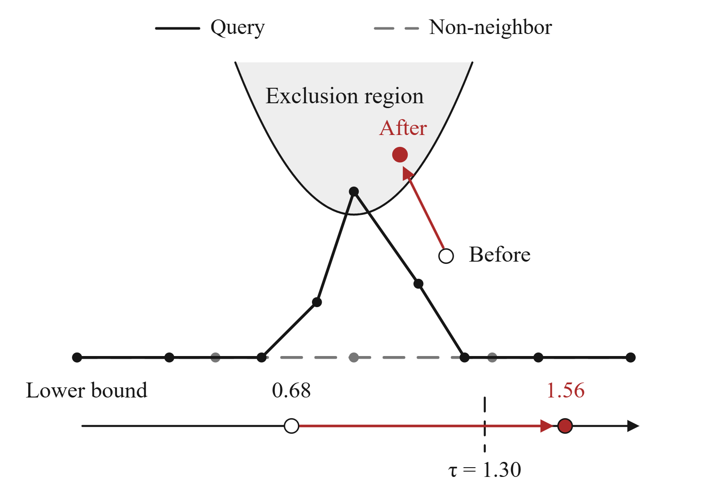

# Learning and Placement

[Code overview](../../README.md) / [Training commands](../../../11_docs/training.md) / [Formula index](../../../11_docs/paper-map/README.md)

Probe learning separates near neighbors from competing non-neighbors. Placement
selects complementary probe positions. DTW also learns the weights of its compact
ordered summary.

This illustration explains the mechanism. Its numbers are not a training log.

## Probe Objectives

| Paper expression | Meaning and code |
| --- | --- |
| (21) `eq:boundary-loss` | Move a competing bound toward the target between the neighbor radius and the original distance. See [phase1_train.py](../../../06_reproduction/training_sources/phase1_train.py#L97), `targets`, `deficits`, and `rank_loss`. |
| (23) `eq:witness-gap` | The theoretical bound gap is at most twice the distance to a critical position. [diagnostic_kernel.py](../../../06_reproduction/training_sources/diagnostic_kernel.py) locates critical vertices, and [phase2_train.py](../../../06_reproduction/training_sources/phase2_train.py#L128) uses their distances. The inequality itself is a proposition, not a runtime function. |
| Training radius `r`, negative ranks, and target `tau` | [phase1_train.py](../../../06_reproduction/training_sources/phase1_train.py#L49) constructs true neighbors and mines boundary negatives. |
| Auxiliary penalty and combined loss | [phase2_train.py](../../../06_reproduction/training_sources/phase2_train.py#L124) computes `delta`, a detached active indicator, the hinge penalty, and their weighted sum. |
| Probe positions exceeding a pair's target and the sufficient disk | [covers_kernel](../../../06_reproduction/training_sources/place.py#L22) checks the actual single-probe bound and the sufficient critical-position condition separately. |
| Fixed-count placement and capped coverage target | [choose](../../../06_reproduction/training_sources/place.py#L50) selects complementary positions. The [caller](../../../06_reproduction/training_sources/place.py#L158) applies the remaining per-query quota. This is a greedy selection rule, not a global-optimum guarantee. |
| Point-set HD adaptation | [sdd_point_fields.py](../../../06_reproduction/training_sources/sdd/sdd_point_fields.py) and [sdd_probe_train.py](../../../06_reproduction/training_sources/sdd/sdd_probe_train.py) substitute the point-set target and fields. |
| DFD adaptation | [sdd_dfd_train.py](../../../06_reproduction/training_sources/sdd/sdd_dfd_train.py) uses DFD labels, nearest-vertex fields, and fixed endpoint terms. |

## DTW Objectives

| Component | Code |
| --- | --- |
| (22) `eq:dtw-signal-loss`: signal-probe ranking loss, with margins from original DTW differences | [ranking_loss](train_dtw_probes.py#L78), gradients through [differentiable_pairs](../dtw/dtw_signal.py#L120) |
| (24) `eq:dtw-summary-loss`: pool inclusion loss for summary training | [coverage_loss](../dtw/dtw_routing.py#L138), used by [train_dtw_routing.py](train_dtw_routing.py) |
| Additional threshold-aware summary objective retained in the release | [finetune_dtw_routing.py](finetune_dtw_routing.py), [dtw_aligned_loss.py](../dtw/dtw_aligned_loss.py) |

The last row is separate from the paper's basic pool-inclusion objective.
The [checkpoint manifest](../../../03_checkpoints/README.md) identifies the
actual parameter bundle. Training source snapshots retain their original
orchestration assumptions. Consult [training instructions](../../../11_docs/training.md)
before launching a recipe.
