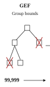
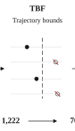
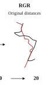

<h1 align="center">LEAP</h1>
<p align="center"><strong>Learned Probes for Exact Trajectory Similarity Search</strong></p>

<p align="center">
  <a href="#quick-start"><strong>One-command demo</strong></a> &middot;
  <a href="https://drive.google.com/file/d/1a-CzXT0ud6JcAKAfplpej_nyHtuDEM8T/view?usp=sharing"><strong>Download Geolife (211 MB)</strong></a>
</p>

Find similar trajectories with **Hausdorff**, **DFD**, and **DTW**. Learned probes rank candidates and prune unnecessary distance calculations.

<p align="center">
  <a href="01_LEAP/leap/common/README.md#gef" title="GEF: group filtering code"></a><a href="01_LEAP/leap/common/README.md#tbf" title="TBF: trajectory filtering code"></a><a href="01_LEAP/leap/common/README.md#rgr" title="RGR: original-distance refinement code"></a>
</p>

<p align="center">
  <a href="01_LEAP/leap/hausdorff/README.md">Hausdorff</a> &middot;
  <a href="01_LEAP/leap/dfd/README.md">DFD</a> &middot;
  <a href="01_LEAP/leap/dtw/README.md">DTW</a> &middot;
  <a href="11_docs/paper-map/README.md">Paper to Code</a> &middot;
  <a href="#appendix">Appendix</a> &middot;
  <a href="15_appendix/LEAP_Appendix.pdf">Proofs (PDF)</a>
</p>

## Quick Start

**Geolife Hausdorff: 1,000 queries, 9,386 trajectories.** Checks dependencies, asks before downloading, loads the trained checkpoint, and prints **HR@20 and time** for Ranking and Full search. Results go to `14_logs/entrance/`.

**Linux + NVIDIA GPU.** With Conda installed, copy and run:

```bash
conda create -n leap python=3.11 -y
conda activate leap
git clone https://github.com/DongXinfzu/LEAP.git
cd LEAP
python entrance.py
```

Enter `y` when asked to install or download. Missing dependencies are installed in the project-local `.venv-entrance`, and the launcher switches to it automatically; your Conda environment is unchanged. An existing Python 3.10-3.12 environment also works.

Allow **2 GB data disk space, 4 GiB available RAM and 4 GiB free GPU memory**, plus runtime packages. Already downloaded? Use `python entrance.py --archive /path/to/LEAP_Geolife_Hausdorff.zip`. For Porto, use `python entrance.py --dataset porto`.

| Run | Reproduce | Explore |
| --- | --- | --- |
| [First query](11_docs/quick_start.md) | [Accuracy and timing](11_docs/reproduction.md) | [Formulas and figures](11_docs/paper-map/README.md) |
| [Datasets and preparation](04_data/README.md) | [Training](11_docs/training.md) | [External models](07_external_models/external_models/README.md) |
| [Configurations](11_docs/configuration.md) | [Seed-2000 checkpoints](03_checkpoints/README.md) | [Logs](14_logs/README.md) |

[Installation help](11_docs/installation.md) &middot; [Code structure](01_LEAP/README.md) &middot; [Authors](11_docs/AUTHORS.md) &middot; [License](LICENSE) &middot; [Third-party notices](THIRD_PARTY_NOTICES.md)

## Retrieval Accuracy

Three seeds (2000, 2001, 2002). Ranking: mean &plusmn; standard deviation. Full search: scores rounded as in the paper.

### Self-100K

Vertex to segment Hausdorff.

<table>
<thead>
<tr><th rowspan="2">Dataset</th><th rowspan="2">Method</th><th colspan="4">Hausdorff</th><th colspan="4">DFD</th><th colspan="4">DTW</th></tr>
<tr><th>HR@1</th><th>HR@20</th><th>R5@20</th><th>HR@1000</th><th>HR@1</th><th>HR@20</th><th>R5@20</th><th>HR@1000</th><th>HR@1</th><th>HR@20</th><th>R5@20</th><th>HR@1000</th></tr>
</thead>
<tbody>
<tr><td rowspan="9">Porto</td><td>ConvTraj</td><td align="right">0.402<sub>&plusmn;0.006</sub></td><td align="right">0.622<sub>&plusmn;0.004</sub></td><td align="right">0.861<sub>&plusmn;0.003</sub></td><td align="right">0.774<sub>&plusmn;0.000</sub></td><td align="right">0.416<sub>&plusmn;0.002</sub></td><td align="right">0.648<sub>&plusmn;0.004</sub></td><td align="right">0.883<sub>&plusmn;0.002</sub></td><td align="right">0.774<sub>&plusmn;0.002</sub></td><td align="right">0.281<sub>&plusmn;0.006</sub></td><td align="right"><ins>0.554</ins><sub>&plusmn;0.007</sub></td><td align="right">0.762<sub>&plusmn;0.009</sub></td><td align="right">0.798<sub>&plusmn;0.002</sub></td></tr>
<tr><td>TrajCL</td><td align="right">0.323<sub>&plusmn;0.004</sub></td><td align="right">0.543<sub>&plusmn;0.001</sub></td><td align="right">0.787<sub>&plusmn;0.002</sub></td><td align="right">0.726<sub>&plusmn;0.000</sub></td><td align="right">0.312<sub>&plusmn;0.001</sub></td><td align="right">0.536<sub>&plusmn;0.001</sub></td><td align="right">0.789<sub>&plusmn;0.000</sub></td><td align="right">0.736<sub>&plusmn;0.001</sub></td><td align="right">0.118<sub>&plusmn;0.003</sub></td><td align="right">0.257<sub>&plusmn;0.004</sub></td><td align="right">0.375<sub>&plusmn;0.004</sub></td><td align="right">0.523<sub>&plusmn;0.005</sub></td></tr>
<tr><td>MovSemCL</td><td align="right">0.330<sub>&plusmn;0.005</sub></td><td align="right">0.551<sub>&plusmn;0.003</sub></td><td align="right">0.797<sub>&plusmn;0.004</sub></td><td align="right">0.730<sub>&plusmn;0.001</sub></td><td align="right">0.296<sub>&plusmn;0.001</sub></td><td align="right">0.530<sub>&plusmn;0.002</sub></td><td align="right">0.778<sub>&plusmn;0.002</sub></td><td align="right">0.736<sub>&plusmn;0.000</sub></td><td align="right">0.121<sub>&plusmn;0.001</sub></td><td align="right">0.264<sub>&plusmn;0.002</sub></td><td align="right">0.384<sub>&plusmn;0.004</sub></td><td align="right">0.531<sub>&plusmn;0.006</sub></td></tr>
<tr><td>SIMformer</td><td align="right">0.382<sub>&plusmn;0.001</sub></td><td align="right">0.595<sub>&plusmn;0.000</sub></td><td align="right">0.844<sub>&plusmn;0.000</sub></td><td align="right">0.759<sub>&plusmn;0.000</sub></td><td align="right">0.374<sub>&plusmn;0.002</sub></td><td align="right">0.608<sub>&plusmn;0.000</sub></td><td align="right">0.852<sub>&plusmn;0.001</sub></td><td align="right">0.763<sub>&plusmn;0.002</sub></td><td align="right">0.112<sub>&plusmn;0.001</sub></td><td align="right">0.277<sub>&plusmn;0.002</sub></td><td align="right">0.378<sub>&plusmn;0.003</sub></td><td align="right">0.585<sub>&plusmn;0.004</sub></td></tr>
<tr><td>TSMini</td><td align="right">0.378<sub>&plusmn;0.001</sub></td><td align="right">0.603<sub>&plusmn;0.001</sub></td><td align="right">0.849<sub>&plusmn;0.000</sub></td><td align="right">0.793<sub>&plusmn;0.003</sub></td><td align="right">0.388<sub>&plusmn;0.010</sub></td><td align="right">0.622<sub>&plusmn;0.006</sub></td><td align="right">0.868<sub>&plusmn;0.006</sub></td><td align="right">0.798<sub>&plusmn;0.006</sub></td><td align="right">0.242<sub>&plusmn;0.004</sub></td><td align="right">0.502<sub>&plusmn;0.006</sub></td><td align="right">0.675<sub>&plusmn;0.006</sub></td><td align="right"><ins>0.836</ins><sub>&plusmn;0.008</sub></td></tr>
<tr><td>TrajAgg</td><td align="right">0.483<sub>&plusmn;0.002</sub></td><td align="right">0.700<sub>&plusmn;0.003</sub></td><td align="right">0.903<sub>&plusmn;0.001</sub></td><td align="right">0.887<sub>&plusmn;0.002</sub></td><td align="right">0.479<sub>&plusmn;0.004</sub></td><td align="right">0.733<sub>&plusmn;0.003</sub></td><td align="right">0.915<sub>&plusmn;0.002</sub></td><td align="right">0.893<sub>&plusmn;0.006</sub></td><td align="right">0.156<sub>&plusmn;0.001</sub></td><td align="right">0.329<sub>&plusmn;0.001</sub></td><td align="right">0.471<sub>&plusmn;0.003</sub></td><td align="right">0.601<sub>&plusmn;0.004</sub></td></tr>
<tr><td>LB-TrajRep</td><td align="right"><ins>0.647</ins><sub>&plusmn;0.005</sub></td><td align="right"><ins>0.817</ins><sub>&plusmn;0.004</sub></td><td align="right"><ins>0.969</ins><sub>&plusmn;0.001</sub></td><td align="right"><ins>0.930</ins><sub>&plusmn;0.001</sub></td><td align="right"><ins>0.609</ins><sub>&plusmn;0.007</sub></td><td align="right"><ins>0.840</ins><sub>&plusmn;0.007</sub></td><td align="right"><ins>0.965</ins><sub>&plusmn;0.002</sub></td><td align="right"><ins>0.937</ins><sub>&plusmn;0.004</sub></td><td align="right"><ins>0.393</ins><sub>&plusmn;0.001</sub></td><td align="right">0.534<sub>&plusmn;0.000</sub></td><td align="right"><ins>0.787</ins><sub>&plusmn;0.000</sub></td><td align="right">0.574<sub>&plusmn;0.000</sub></td></tr>
<tr><td>LEAP&nbsp;(ranking)</td><td align="right"><strong>0.683</strong><sub>&plusmn;0.001</sub></td><td align="right"><strong>0.829</strong><sub>&plusmn;0.001</sub></td><td align="right"><strong>0.979</strong><sub>&plusmn;0.000</sub></td><td align="right"><strong>0.940</strong><sub>&plusmn;0.004</sub></td><td align="right"><strong>0.743</strong><sub>&plusmn;0.001</sub></td><td align="right"><strong>0.913</strong><sub>&plusmn;0.001</sub></td><td align="right"><strong>0.986</strong><sub>&plusmn;0.001</sub></td><td align="right"><strong>0.962</strong><sub>&plusmn;0.000</sub></td><td align="right"><strong>0.978</strong><sub>&plusmn;0.002</sub></td><td align="right"><strong>0.927</strong><sub>&plusmn;0.002</sub></td><td align="right"><strong>0.969</strong><sub>&plusmn;0.001</sub></td><td align="right"><strong>0.987</strong><sub>&plusmn;0.000</sub></td></tr>
<tr><td>LEAP&nbsp;(full&nbsp;search)</td><td align="right">1.000</td><td align="right">1.000</td><td align="right">1.000</td><td align="right">1.000</td><td align="right">1.000</td><td align="right">1.000</td><td align="right">1.000</td><td align="right">1.000</td><td align="right">1.000</td><td align="right">1.000</td><td align="right">1.000</td><td align="right">1.000</td></tr>
<tr><td rowspan="9">Germany</td><td>ConvTraj</td><td align="right">0.385<sub>&plusmn;0.010</sub></td><td align="right">0.651<sub>&plusmn;0.010</sub></td><td align="right">0.858<sub>&plusmn;0.010</sub></td><td align="right">0.893<sub>&plusmn;0.002</sub></td><td align="right">0.444<sub>&plusmn;0.013</sub></td><td align="right">0.657<sub>&plusmn;0.016</sub></td><td align="right">0.882<sub>&plusmn;0.015</sub></td><td align="right">0.880<sub>&plusmn;0.005</sub></td><td align="right">0.283<sub>&plusmn;0.005</sub></td><td align="right">0.472<sub>&plusmn;0.005</sub></td><td align="right">0.675<sub>&plusmn;0.007</sub></td><td align="right"><ins>0.824</ins><sub>&plusmn;0.002</sub></td></tr>
<tr><td>TrajCL</td><td align="right">0.259<sub>&plusmn;0.005</sub></td><td align="right">0.504<sub>&plusmn;0.008</sub></td><td align="right">0.697<sub>&plusmn;0.009</sub></td><td align="right">0.828<sub>&plusmn;0.008</sub></td><td align="right">0.275<sub>&plusmn;0.011</sub></td><td align="right">0.469<sub>&plusmn;0.010</sub></td><td align="right">0.692<sub>&plusmn;0.012</sub></td><td align="right">0.811<sub>&plusmn;0.003</sub></td><td align="right">0.175<sub>&plusmn;0.004</sub></td><td align="right">0.315<sub>&plusmn;0.018</sub></td><td align="right">0.464<sub>&plusmn;0.026</sub></td><td align="right">0.375<sub>&plusmn;0.030</sub></td></tr>
<tr><td>MovSemCL</td><td align="right">0.286<sub>&plusmn;0.002</sub></td><td align="right">0.535<sub>&plusmn;0.003</sub></td><td align="right">0.758<sub>&plusmn;0.003</sub></td><td align="right">0.846<sub>&plusmn;0.000</sub></td><td align="right">0.252<sub>&plusmn;0.030</sub></td><td align="right">0.427<sub>&plusmn;0.035</sub></td><td align="right">0.664<sub>&plusmn;0.033</sub></td><td align="right">0.808<sub>&plusmn;0.012</sub></td><td align="right">0.301<sub>&plusmn;0.010</sub></td><td align="right">0.469<sub>&plusmn;0.010</sub></td><td align="right">0.753<sub>&plusmn;0.020</sub></td><td align="right">0.374<sub>&plusmn;0.023</sub></td></tr>
<tr><td>SIMformer</td><td align="right">0.481<sub>&plusmn;0.011</sub></td><td align="right">0.723<sub>&plusmn;0.005</sub></td><td align="right">0.927<sub>&plusmn;0.006</sub></td><td align="right">0.901<sub>&plusmn;0.001</sub></td><td align="right">0.528<sub>&plusmn;0.007</sub></td><td align="right">0.691<sub>&plusmn;0.004</sub></td><td align="right">0.914<sub>&plusmn;0.003</sub></td><td align="right">0.888<sub>&plusmn;0.000</sub></td><td align="right">0.176<sub>&plusmn;0.008</sub></td><td align="right">0.267<sub>&plusmn;0.013</sub></td><td align="right">0.364<sub>&plusmn;0.014</sub></td><td align="right">0.490<sub>&plusmn;0.004</sub></td></tr>
<tr><td>TSMini</td><td align="right">0.489<sub>&plusmn;0.051</sub></td><td align="right">0.721<sub>&plusmn;0.028</sub></td><td align="right">0.923<sub>&plusmn;0.025</sub></td><td align="right">0.904<sub>&plusmn;0.004</sub></td><td align="right">0.479<sub>&plusmn;0.014</sub></td><td align="right">0.675<sub>&plusmn;0.009</sub></td><td align="right">0.903<sub>&plusmn;0.008</sub></td><td align="right">0.894<sub>&plusmn;0.005</sub></td><td align="right">0.331<sub>&plusmn;0.022</sub></td><td align="right">0.532<sub>&plusmn;0.030</sub></td><td align="right">0.801<sub>&plusmn;0.027</sub></td><td align="right">0.732<sub>&plusmn;0.007</sub></td></tr>
<tr><td>TrajAgg</td><td align="right">0.618<sub>&plusmn;0.010</sub></td><td align="right">0.826<sub>&plusmn;0.009</sub></td><td align="right">0.978<sub>&plusmn;0.002</sub></td><td align="right">0.950<sub>&plusmn;0.002</sub></td><td align="right">0.684<sub>&plusmn;0.015</sub></td><td align="right">0.853<sub>&plusmn;0.013</sub></td><td align="right">0.973<sub>&plusmn;0.006</sub></td><td align="right">0.961<sub>&plusmn;0.005</sub></td><td align="right">0.176<sub>&plusmn;0.001</sub></td><td align="right">0.258<sub>&plusmn;0.001</sub></td><td align="right">0.358<sub>&plusmn;0.000</sub></td><td align="right">0.499<sub>&plusmn;0.002</sub></td></tr>
<tr><td>LB-TrajRep</td><td align="right"><ins>0.791</ins><sub>&plusmn;0.001</sub></td><td align="right"><ins>0.921</ins><sub>&plusmn;0.001</sub></td><td align="right"><ins>0.996</ins><sub>&plusmn;0.000</sub></td><td align="right"><ins>0.985</ins><sub>&plusmn;0.000</sub></td><td align="right"><ins>0.811</ins><sub>&plusmn;0.001</sub></td><td align="right"><ins>0.938</ins><sub>&plusmn;0.001</sub></td><td align="right"><ins>0.991</ins><sub>&plusmn;0.000</sub></td><td align="right"><ins>0.992</ins><sub>&plusmn;0.000</sub></td><td align="right"><ins>0.502</ins><sub>&plusmn;0.003</sub></td><td align="right"><ins>0.626</ins><sub>&plusmn;0.006</sub></td><td align="right"><ins>0.871</ins><sub>&plusmn;0.004</sub></td><td align="right">0.762<sub>&plusmn;0.003</sub></td></tr>
<tr><td>LEAP&nbsp;(ranking)</td><td align="right"><strong>0.803</strong><sub>&plusmn;0.001</sub></td><td align="right"><strong>0.931</strong><sub>&plusmn;0.000</sub></td><td align="right"><strong>0.997</strong><sub>&plusmn;0.000</sub></td><td align="right"><strong>0.989</strong><sub>&plusmn;0.000</sub></td><td align="right"><strong>0.910</strong><sub>&plusmn;0.001</sub></td><td align="right"><strong>0.967</strong><sub>&plusmn;0.000</sub></td><td align="right"><strong>0.995</strong><sub>&plusmn;0.000</sub></td><td align="right"><strong>0.997</strong><sub>&plusmn;0.000</sub></td><td align="right"><strong>0.992</strong><sub>&plusmn;0.000</sub></td><td align="right"><strong>0.979</strong><sub>&plusmn;0.002</sub></td><td align="right"><strong>0.993</strong><sub>&plusmn;0.001</sub></td><td align="right"><strong>0.997</strong><sub>&plusmn;0.000</sub></td></tr>
<tr><td>LEAP&nbsp;(full&nbsp;search)</td><td align="right">1.000</td><td align="right">1.000</td><td align="right">1.000</td><td align="right">1.000</td><td align="right">1.000</td><td align="right">1.000</td><td align="right">1.000</td><td align="right">1.000</td><td align="right">1.000</td><td align="right">1.000</td><td align="right">1.000</td><td align="right">1.000</td></tr>
</tbody>
</table>

### SDD

Point set Hausdorff.

<table>
<thead>
<tr><th rowspan="2">Dataset</th><th rowspan="2">Method</th><th colspan="4">Hausdorff</th><th colspan="4">DFD</th><th colspan="4">DTW</th></tr>
<tr><th>HR@1</th><th>HR@20</th><th>R5@20</th><th>HR@1000</th><th>HR@1</th><th>HR@20</th><th>R5@20</th><th>HR@1000</th><th>HR@1</th><th>HR@20</th><th>R5@20</th><th>HR@1000</th></tr>
</thead>
<tbody>
<tr><td rowspan="9">Porto</td><td>ConvTraj</td><td align="right">0.139<sub>&plusmn;0.004</sub></td><td align="right">0.356<sub>&plusmn;0.001</sub></td><td align="right">0.499<sub>&plusmn;0.009</sub></td><td align="right">0.617<sub>&plusmn;0.006</sub></td><td align="right">0.157<sub>&plusmn;0.007</sub></td><td align="right">0.401<sub>&plusmn;0.012</sub></td><td align="right">0.563<sub>&plusmn;0.018</sub></td><td align="right">0.660<sub>&plusmn;0.006</sub></td><td align="right">0.118<sub>&plusmn;0.014</sub></td><td align="right">0.255<sub>&plusmn;0.006</sub></td><td align="right">0.362<sub>&plusmn;0.004</sub></td><td align="right">0.560<sub>&plusmn;0.000</sub></td></tr>
<tr><td>TrajCL</td><td align="right">0.045<sub>&plusmn;0.001</sub></td><td align="right">0.134<sub>&plusmn;0.003</sub></td><td align="right">0.181<sub>&plusmn;0.003</sub></td><td align="right">0.273<sub>&plusmn;0.005</sub></td><td align="right">0.056<sub>&plusmn;0.005</sub></td><td align="right">0.140<sub>&plusmn;0.002</sub></td><td align="right">0.188<sub>&plusmn;0.004</sub></td><td align="right">0.283<sub>&plusmn;0.019</sub></td><td align="right">0.071<sub>&plusmn;0.009</sub></td><td align="right">0.180<sub>&plusmn;0.004</sub></td><td align="right">0.247<sub>&plusmn;0.008</sub></td><td align="right">0.339<sub>&plusmn;0.003</sub></td></tr>
<tr><td>MovSemCL</td><td align="right">0.121<sub>&plusmn;0.012</sub></td><td align="right">0.274<sub>&plusmn;0.018</sub></td><td align="right">0.388<sub>&plusmn;0.029</sub></td><td align="right">0.453<sub>&plusmn;0.015</sub></td><td align="right">0.113<sub>&plusmn;0.013</sub></td><td align="right">0.263<sub>&plusmn;0.014</sub></td><td align="right">0.384<sub>&plusmn;0.024</sub></td><td align="right">0.371<sub>&plusmn;0.019</sub></td><td align="right">0.156<sub>&plusmn;0.002</sub></td><td align="right">0.322<sub>&plusmn;0.003</sub></td><td align="right">0.471<sub>&plusmn;0.005</sub></td><td align="right">0.465<sub>&plusmn;0.004</sub></td></tr>
<tr><td>SIMformer</td><td align="right">0.165<sub>&plusmn;0.006</sub></td><td align="right">0.385<sub>&plusmn;0.001</sub></td><td align="right">0.537<sub>&plusmn;0.001</sub></td><td align="right">0.640<sub>&plusmn;0.001</sub></td><td align="right">0.169<sub>&plusmn;0.004</sub></td><td align="right">0.400<sub>&plusmn;0.006</sub></td><td align="right">0.568<sub>&plusmn;0.008</sub></td><td align="right">0.654<sub>&plusmn;0.002</sub></td><td align="right">0.041<sub>&plusmn;0.006</sub></td><td align="right">0.125<sub>&plusmn;0.001</sub></td><td align="right">0.161<sub>&plusmn;0.003</sub></td><td align="right">0.331<sub>&plusmn;0.001</sub></td></tr>
<tr><td>TSMini</td><td align="right">0.113<sub>&plusmn;0.001</sub></td><td align="right">0.324<sub>&plusmn;0.009</sub></td><td align="right">0.457<sub>&plusmn;0.015</sub></td><td align="right">0.613<sub>&plusmn;0.009</sub></td><td align="right">0.131<sub>&plusmn;0.006</sub></td><td align="right">0.358<sub>&plusmn;0.003</sub></td><td align="right">0.529<sub>&plusmn;0.007</sub></td><td align="right">0.641<sub>&plusmn;0.006</sub></td><td align="right">0.095<sub>&plusmn;0.007</sub></td><td align="right">0.252<sub>&plusmn;0.004</sub></td><td align="right">0.344<sub>&plusmn;0.003</sub></td><td align="right"><ins>0.572</ins><sub>&plusmn;0.002</sub></td></tr>
<tr><td>TrajAgg</td><td align="right">0.195<sub>&plusmn;0.011</sub></td><td align="right">0.448<sub>&plusmn;0.013</sub></td><td align="right">0.626<sub>&plusmn;0.010</sub></td><td align="right">0.722<sub>&plusmn;0.013</sub></td><td align="right">0.227<sub>&plusmn;0.014</sub></td><td align="right">0.507<sub>&plusmn;0.007</sub></td><td align="right">0.676<sub>&plusmn;0.019</sub></td><td align="right">0.773<sub>&plusmn;0.007</sub></td><td align="right">0.087<sub>&plusmn;0.006</sub></td><td align="right">0.190<sub>&plusmn;0.001</sub></td><td align="right">0.268<sub>&plusmn;0.004</sub></td><td align="right">0.389<sub>&plusmn;0.005</sub></td></tr>
<tr><td>LB-TrajRep</td><td align="right"><ins>0.256</ins><sub>&plusmn;0.010</sub></td><td align="right"><ins>0.551</ins><sub>&plusmn;0.005</sub></td><td align="right"><ins>0.745</ins><sub>&plusmn;0.007</sub></td><td align="right"><ins>0.815</ins><sub>&plusmn;0.002</sub></td><td align="right"><ins>0.331</ins><sub>&plusmn;0.013</sub></td><td align="right"><ins>0.631</ins><sub>&plusmn;0.004</sub></td><td align="right"><ins>0.799</ins><sub>&plusmn;0.001</sub></td><td align="right"><ins>0.870</ins><sub>&plusmn;0.004</sub></td><td align="right"><ins>0.233</ins><sub>&plusmn;0.006</sub></td><td align="right"><ins>0.445</ins><sub>&plusmn;0.001</sub></td><td align="right"><ins>0.661</ins><sub>&plusmn;0.003</sub></td><td align="right">0.549<sub>&plusmn;0.001</sub></td></tr>
<tr><td>LEAP&nbsp;(ranking)</td><td align="right"><strong>0.285</strong><sub>&plusmn;0.005</sub></td><td align="right"><strong>0.587</strong><sub>&plusmn;0.001</sub></td><td align="right"><strong>0.772</strong><sub>&plusmn;0.002</sub></td><td align="right"><strong>0.855</strong><sub>&plusmn;0.001</sub></td><td align="right"><strong>0.500</strong><sub>&plusmn;0.002</sub></td><td align="right"><strong>0.757</strong><sub>&plusmn;0.001</sub></td><td align="right"><strong>0.892</strong><sub>&plusmn;0.000</sub></td><td align="right"><strong>0.941</strong><sub>&plusmn;0.000</sub></td><td align="right"><strong>0.864</strong><sub>&plusmn;0.021</sub></td><td align="right"><strong>0.741</strong><sub>&plusmn;0.012</sub></td><td align="right"><strong>0.825</strong><sub>&plusmn;0.013</sub></td><td align="right"><strong>0.938</strong><sub>&plusmn;0.003</sub></td></tr>
<tr><td>LEAP&nbsp;(full&nbsp;search)</td><td align="right">1.000</td><td align="right">1.000</td><td align="right">1.000</td><td align="right">1.000</td><td align="right">1.000</td><td align="right">1.000</td><td align="right">1.000</td><td align="right">1.000</td><td align="right">1.000</td><td align="right">1.000</td><td align="right">1.000</td><td align="right">1.000</td></tr>
<tr><td rowspan="9">Geolife</td><td>ConvTraj</td><td align="right">0.405<sub>&plusmn;0.013</sub></td><td align="right">0.639<sub>&plusmn;0.004</sub></td><td align="right">0.833<sub>&plusmn;0.007</sub></td><td align="right">0.887<sub>&plusmn;0.002</sub></td><td align="right">0.473<sub>&plusmn;0.011</sub></td><td align="right">0.692<sub>&plusmn;0.003</sub></td><td align="right">0.881<sub>&plusmn;0.006</sub></td><td align="right">0.876<sub>&plusmn;0.003</sub></td><td align="right">0.332<sub>&plusmn;0.011</sub></td><td align="right">0.467<sub>&plusmn;0.003</sub></td><td align="right">0.660<sub>&plusmn;0.002</sub></td><td align="right">0.648<sub>&plusmn;0.008</sub></td></tr>
<tr><td>TrajCL</td><td align="right">0.247<sub>&plusmn;0.005</sub></td><td align="right">0.386<sub>&plusmn;0.004</sub></td><td align="right">0.559<sub>&plusmn;0.009</sub></td><td align="right">0.402<sub>&plusmn;0.006</sub></td><td align="right">0.248<sub>&plusmn;0.003</sub></td><td align="right">0.330<sub>&plusmn;0.004</sub></td><td align="right">0.514<sub>&plusmn;0.009</sub></td><td align="right">0.575<sub>&plusmn;0.185</sub></td><td align="right">0.252<sub>&plusmn;0.003</sub></td><td align="right">0.348<sub>&plusmn;0.008</sub></td><td align="right">0.550<sub>&plusmn;0.009</sub></td><td align="right">0.352<sub>&plusmn;0.011</sub></td></tr>
<tr><td>MovSemCL</td><td align="right">0.312<sub>&plusmn;0.018</sub></td><td align="right">0.474<sub>&plusmn;0.003</sub></td><td align="right">0.680<sub>&plusmn;0.010</sub></td><td align="right">0.800<sub>&plusmn;0.002</sub></td><td align="right">0.299<sub>&plusmn;0.007</sub></td><td align="right">0.397<sub>&plusmn;0.004</sub></td><td align="right">0.638<sub>&plusmn;0.010</sub></td><td align="right">0.467<sub>&plusmn;0.218</sub></td><td align="right">0.317<sub>&plusmn;0.008</sub></td><td align="right">0.414<sub>&plusmn;0.002</sub></td><td align="right">0.676<sub>&plusmn;0.006</sub></td><td align="right">0.282<sub>&plusmn;0.009</sub></td></tr>
<tr><td>SIMformer</td><td align="right">0.510<sub>&plusmn;0.018</sub></td><td align="right">0.714<sub>&plusmn;0.004</sub></td><td align="right">0.911<sub>&plusmn;0.003</sub></td><td align="right">0.908<sub>&plusmn;0.001</sub></td><td align="right">0.517<sub>&plusmn;0.006</sub></td><td align="right">0.727<sub>&plusmn;0.003</sub></td><td align="right">0.920<sub>&plusmn;0.001</sub></td><td align="right">0.896<sub>&plusmn;0.001</sub></td><td align="right">0.300<sub>&plusmn;0.008</sub></td><td align="right">0.431<sub>&plusmn;0.006</sub></td><td align="right">0.649<sub>&plusmn;0.003</sub></td><td align="right">0.633<sub>&plusmn;0.003</sub></td></tr>
<tr><td>TSMini</td><td align="right">0.208<sub>&plusmn;0.019</sub></td><td align="right">0.376<sub>&plusmn;0.055</sub></td><td align="right">0.520<sub>&plusmn;0.072</sub></td><td align="right">0.780<sub>&plusmn;0.039</sub></td><td align="right">0.356<sub>&plusmn;0.002</sub></td><td align="right">0.612<sub>&plusmn;0.001</sub></td><td align="right">0.803<sub>&plusmn;0.007</sub></td><td align="right">0.857<sub>&plusmn;0.011</sub></td><td align="right">0.282<sub>&plusmn;0.015</sub></td><td align="right">0.483<sub>&plusmn;0.009</sub></td><td align="right">0.647<sub>&plusmn;0.015</sub></td><td align="right"><ins>0.787</ins><sub>&plusmn;0.001</sub></td></tr>
<tr><td>TrajAgg</td><td align="right">0.563<sub>&plusmn;0.008</sub></td><td align="right">0.792<sub>&plusmn;0.007</sub></td><td align="right">0.933<sub>&plusmn;0.004</sub></td><td align="right">0.964<sub>&plusmn;0.003</sub></td><td align="right">0.616<sub>&plusmn;0.009</sub></td><td align="right">0.832<sub>&plusmn;0.002</sub></td><td align="right">0.958<sub>&plusmn;0.006</sub></td><td align="right">0.962<sub>&plusmn;0.002</sub></td><td align="right">0.250<sub>&plusmn;0.005</sub></td><td align="right">0.341<sub>&plusmn;0.004</sub></td><td align="right">0.500<sub>&plusmn;0.004</sub></td><td align="right">0.602<sub>&plusmn;0.004</sub></td></tr>
<tr><td>LB-TrajRep</td><td align="right"><ins>0.753</ins><sub>&plusmn;0.003</sub></td><td align="right"><ins>0.909</ins><sub>&plusmn;0.002</sub></td><td align="right"><ins>0.989</ins><sub>&plusmn;0.000</sub></td><td align="right"><ins>0.990</ins><sub>&plusmn;0.000</sub></td><td align="right"><ins>0.803</ins><sub>&plusmn;0.004</sub></td><td align="right"><ins>0.944</ins><sub>&plusmn;0.003</sub></td><td align="right"><ins>0.997</ins><sub>&plusmn;0.001</sub></td><td align="right"><ins>0.995</ins><sub>&plusmn;0.000</sub></td><td align="right"><ins>0.444</ins><sub>&plusmn;0.003</sub></td><td align="right"><ins>0.554</ins><sub>&plusmn;0.000</sub></td><td align="right"><ins>0.779</ins><sub>&plusmn;0.001</sub></td><td align="right">0.664<sub>&plusmn;0.000</sub></td></tr>
<tr><td>LEAP&nbsp;(ranking)</td><td align="right"><strong>0.782</strong><sub>&plusmn;0.004</sub></td><td align="right"><strong>0.929</strong><sub>&plusmn;0.004</sub></td><td align="right"><strong>0.993</strong><sub>&plusmn;0.000</sub></td><td align="right"><strong>0.994</strong><sub>&plusmn;0.000</sub></td><td align="right"><strong>0.919</strong><sub>&plusmn;0.001</sub></td><td align="right"><strong>0.975</strong><sub>&plusmn;0.001</sub></td><td align="right"><strong>0.998</strong><sub>&plusmn;0.000</sub></td><td align="right"><strong>0.996</strong><sub>&plusmn;0.000</sub></td><td align="right"><strong>0.981</strong><sub>&plusmn;0.004</sub></td><td align="right"><strong>0.945</strong><sub>&plusmn;0.002</sub></td><td align="right"><strong>0.975</strong><sub>&plusmn;0.001</sub></td><td align="right"><strong>0.995</strong><sub>&plusmn;0.003</sub></td></tr>
<tr><td>LEAP&nbsp;(full&nbsp;search)</td><td align="right">1.000</td><td align="right">1.000</td><td align="right">1.000</td><td align="right">1.000</td><td align="right">1.000</td><td align="right">1.000</td><td align="right">1.000</td><td align="right">1.000</td><td align="right">1.000</td><td align="right">1.000</td><td align="right">1.000</td><td align="right">1.000</td></tr>
<tr><td rowspan="9">Chengdu</td><td>ConvTraj</td><td align="right">0.301<sub>&plusmn;0.018</sub></td><td align="right">0.558<sub>&plusmn;0.029</sub></td><td align="right">0.787<sub>&plusmn;0.031</sub></td><td align="right">0.874<sub>&plusmn;0.008</sub></td><td align="right">0.413<sub>&plusmn;0.008</sub></td><td align="right">0.663<sub>&plusmn;0.012</sub></td><td align="right">0.903<sub>&plusmn;0.009</sub></td><td align="right">0.868<sub>&plusmn;0.004</sub></td><td align="right">0.322<sub>&plusmn;0.005</sub></td><td align="right">0.559<sub>&plusmn;0.007</sub></td><td align="right">0.766<sub>&plusmn;0.007</sub></td><td align="right">0.835<sub>&plusmn;0.006</sub></td></tr>
<tr><td>TrajCL</td><td align="right">0.151<sub>&plusmn;0.012</sub></td><td align="right">0.280<sub>&plusmn;0.010</sub></td><td align="right">0.413<sub>&plusmn;0.009</sub></td><td align="right">0.748<sub>&plusmn;0.097</sub></td><td align="right">0.116<sub>&plusmn;0.017</sub></td><td align="right">0.206<sub>&plusmn;0.005</sub></td><td align="right">0.340<sub>&plusmn;0.010</sub></td><td align="right">0.678<sub>&plusmn;0.087</sub></td><td align="right">0.151<sub>&plusmn;0.028</sub></td><td align="right">0.244<sub>&plusmn;0.038</sub></td><td align="right">0.393<sub>&plusmn;0.066</sub></td><td align="right">0.620<sub>&plusmn;0.160</sub></td></tr>
<tr><td>MovSemCL</td><td align="right">0.274<sub>&plusmn;0.012</sub></td><td align="right">0.374<sub>&plusmn;0.005</sub></td><td align="right">0.585<sub>&plusmn;0.008</sub></td><td align="right">0.510<sub>&plusmn;0.089</sub></td><td align="right">0.213<sub>&plusmn;0.010</sub></td><td align="right">0.259<sub>&plusmn;0.003</sub></td><td align="right">0.469<sub>&plusmn;0.009</sub></td><td align="right">0.455<sub>&plusmn;0.098</sub></td><td align="right">0.302<sub>&plusmn;0.008</sub></td><td align="right">0.377<sub>&plusmn;0.002</sub></td><td align="right">0.657<sub>&plusmn;0.003</sub></td><td align="right">0.466<sub>&plusmn;0.017</sub></td></tr>
<tr><td>SIMformer</td><td align="right">0.444<sub>&plusmn;0.009</sub></td><td align="right">0.706<sub>&plusmn;0.002</sub></td><td align="right">0.932<sub>&plusmn;0.002</sub></td><td align="right">0.913<sub>&plusmn;0.002</sub></td><td align="right">0.473<sub>&plusmn;0.006</sub></td><td align="right">0.717<sub>&plusmn;0.002</sub></td><td align="right">0.948<sub>&plusmn;0.002</sub></td><td align="right">0.893<sub>&plusmn;0.002</sub></td><td align="right">0.308<sub>&plusmn;0.004</sub></td><td align="right">0.579<sub>&plusmn;0.003</sub></td><td align="right">0.766<sub>&plusmn;0.003</sub></td><td align="right">0.839<sub>&plusmn;0.005</sub></td></tr>
<tr><td>TSMini</td><td align="right">0.392<sub>&plusmn;0.009</sub></td><td align="right">0.671<sub>&plusmn;0.007</sub></td><td align="right">0.894<sub>&plusmn;0.010</sub></td><td align="right">0.866<sub>&plusmn;0.003</sub></td><td align="right">0.341<sub>&plusmn;0.033</sub></td><td align="right">0.638<sub>&plusmn;0.028</sub></td><td align="right">0.848<sub>&plusmn;0.032</sub></td><td align="right">0.859<sub>&plusmn;0.003</sub></td><td align="right">0.334<sub>&plusmn;0.009</sub></td><td align="right"><ins>0.626</ins><sub>&plusmn;0.004</sub></td><td align="right"><ins>0.830</ins><sub>&plusmn;0.005</sub></td><td align="right">0.829<sub>&plusmn;0.005</sub></td></tr>
<tr><td>TrajAgg</td><td align="right">0.498<sub>&plusmn;0.007</sub></td><td align="right">0.791<sub>&plusmn;0.003</sub></td><td align="right">0.961<sub>&plusmn;0.002</sub></td><td align="right">0.964<sub>&plusmn;0.002</sub></td><td align="right">0.570<sub>&plusmn;0.005</sub></td><td align="right">0.803<sub>&plusmn;0.015</sub></td><td align="right">0.963<sub>&plusmn;0.009</sub></td><td align="right">0.943<sub>&plusmn;0.006</sub></td><td align="right"><ins>0.351</ins><sub>&plusmn;0.007</sub></td><td align="right">0.586<sub>&plusmn;0.013</sub></td><td align="right">0.800<sub>&plusmn;0.008</sub></td><td align="right"><ins>0.852</ins><sub>&plusmn;0.008</sub></td></tr>
<tr><td>LB-TrajRep</td><td align="right"><ins>0.736</ins><sub>&plusmn;0.005</sub></td><td align="right"><ins>0.916</ins><sub>&plusmn;0.003</sub></td><td align="right"><ins>0.996</ins><sub>&plusmn;0.000</sub></td><td align="right"><ins>0.993</ins><sub>&plusmn;0.000</sub></td><td align="right"><ins>0.832</ins><sub>&plusmn;0.007</sub></td><td align="right"><ins>0.946</ins><sub>&plusmn;0.002</sub></td><td align="right"><ins>0.998</ins><sub>&plusmn;0.000</sub></td><td align="right"><ins>0.993</ins><sub>&plusmn;0.000</sub></td><td align="right">0.350<sub>&plusmn;0.002</sub></td><td align="right">0.480<sub>&plusmn;0.000</sub></td><td align="right">0.717<sub>&plusmn;0.000</sub></td><td align="right">0.736<sub>&plusmn;0.000</sub></td></tr>
<tr><td>LEAP&nbsp;(ranking)</td><td align="right"><strong>0.782</strong><sub>&plusmn;0.005</sub></td><td align="right"><strong>0.933</strong><sub>&plusmn;0.004</sub></td><td align="right"><strong>0.997</strong><sub>&plusmn;0.001</sub></td><td align="right"><strong>0.994</strong><sub>&plusmn;0.001</sub></td><td align="right"><strong>0.911</strong><sub>&plusmn;0.003</sub></td><td align="right"><strong>0.966</strong><sub>&plusmn;0.000</sub></td><td align="right"><strong>0.999</strong><sub>&plusmn;0.000</sub></td><td align="right"><strong>0.994</strong><sub>&plusmn;0.000</sub></td><td align="right"><strong>0.987</strong><sub>&plusmn;0.003</sub></td><td align="right"><strong>0.961</strong><sub>&plusmn;0.003</sub></td><td align="right"><strong>0.987</strong><sub>&plusmn;0.000</sub></td><td align="right"><strong>0.993</strong><sub>&plusmn;0.005</sub></td></tr>
<tr><td>LEAP&nbsp;(full&nbsp;search)</td><td align="right">1.000</td><td align="right">1.000</td><td align="right">1.000</td><td align="right">1.000</td><td align="right">0.999</td><td align="right">1.000</td><td align="right">1.000</td><td align="right">1.000</td><td align="right">1.000</td><td align="right">1.000</td><td align="right">1.000</td><td align="right">1.000</td></tr>
</tbody>
</table>

## Appendix

[**Read the typeset PDF**](15_appendix/LEAP_Appendix.pdf) | [LaTeX source](15_appendix/LEAP_Appendix.tex)

These supplementary proofs accompany the paper's **Validity** and
**Critical-position proximity** propositions, **weighted DTW block bound**, and
**DTW signal lower bound**. Definitions, full proofs, and boundary handling are
given below.

- [A. Validity of the Cross-Field Bound](#a-validity-of-the-cross-field-bound)
- [B. Critical-Position Proximity](#b-critical-position-proximity)
- [C. Weighted DTW Block Bound](#c-weighted-dtw-block-bound)
- [D. DTW Signal Lower Bound](#d-dtw-signal-lower-bound)

### Notation

For a trajectory $`T`$, let $`V_T`$ be its sampled positions and $`E_T`$ the union of
the line segments joining consecutive positions. The distance from a point $`x`$
to a set $`S`$ is $`\mathrm{dist}(x,S)=\min_{z\in S}\lVert x-z\rVert_2`$.
For probe $`p_j^{\mathrm{pr}}`$, the nearest-position and segment fields are

```math
a_j(T)=\mathrm{dist}(p_j^{\mathrm{pr}},V_T),\qquad
b_j(T)=\mathrm{dist}(p_j^{\mathrm{pr}},E_T).
```

The directed and symmetric vertex-to-segment Hausdorff distances are

```math
\begin{aligned}
h(T_A,T_B)&=\max_{p\in V_{T_A}}\mathrm{dist}(p,E_{T_B}),\\
D_H(T_A,T_B)&=\max\{h(T_A,T_B),h(T_B,T_A)\}.
\end{aligned}
```

The cross-field lower bound combines all probes and both directions:

```math
\begin{aligned}
L_H(T_A,T_B)=\max\bigl\{0,\;&\max_j[b_j(T_B)-a_j(T_A)],\\
&\max_j[b_j(T_A)-a_j(T_B)]\bigr\}.
\end{aligned}
```

### A. Validity of the Cross-Field Bound

**Proposition.** For any probe positions,
$`0\leq L_H(T_A,T_B)\leq D_H(T_A,T_B)`$ in real arithmetic.
Validity does not depend on learning.

**Proof.** Fix $`p_j^{\mathrm{pr}}`$ and choose its nearest position $`p\in V_{T_A}`$.
Apply the Euclidean triangle inequality through $`p`$ to its nearest point on
$`E_{T_B}`$ to obtain

```math
\begin{aligned}
b_j(T_B)&=\mathrm{dist}(p_j^{\mathrm{pr}},E_{T_B})\\
&\leq\lVert p_j^{\mathrm{pr}}-p\rVert_2+\mathrm{dist}(p,E_{T_B})\\
&\leq a_j(T_A)+h(T_A,T_B).
\end{aligned}
```

Hence $`b_j(T_B)-a_j(T_A)\leq h(T_A,T_B)`$. Interchanging $`T_A`$ and $`T_B`$
proves the other direction. Taking the maximum over probes and both directions,
with zero included, yields the result.

### B. Critical-Position Proximity

A **critical position** $`p^*`$ is a sampled position that attains
$`D_H(T_A,T_B)`$ in either direction. For probe set $`\Theta`$, let
$`\delta_\Theta(p^*)=\min_j\lVert p_j^{\mathrm{pr}}-p^*\rVert_2`$ be its distance
to the nearest probe.

**Proposition.** For any critical position $`p^*`$,

```math
0\leq D_H(T_A,T_B)-L_H(T_A,T_B)\leq 2\delta_\Theta(p^*).
```

**Proof.** Suppose $`p^*\in V_{T_A}`$ and
$`\mathrm{dist}(p^*,E_{T_B})=D_H(T_A,T_B)`$. Choose the nearest probe
$`p_j^{\mathrm{pr}}`$, at distance $`\delta=\delta_\Theta(p^*)`$.
By the same triangle-inequality argument,
$`b_j(T_B)\geq D_H(T_A,T_B)-\delta`$. Since $`p^*`$ is a position of $`T_A`$,
$`a_j(T_A)\leq\delta`$. Therefore

```math
L_H(T_A,T_B)\geq b_j(T_B)-a_j(T_A)\geq D_H(T_A,T_B)-2\delta.
```

The case $`p^*\in V_{T_B}`$ follows by symmetry, and validity gives nonnegativity.

### C. Weighted DTW Block Bound

This bound is a Level 3 check before original-distance refinement, not the
signal bound used for candidate ranking. It follows the paper's
**DTW** subsection under **Filtering and Exact Search**.

#### Blocks and Costs

Let $`q=(p_1^q,\ldots,p_n^q)`$ and $`T=(p_1^T,\ldots,p_m^T)`$ be nonempty
trajectories. Their DTW distance $`D_W(q,T)`$ is the minimum sum of Euclidean
point-to-point distances along an alignment from $`(1,1)`$ to $`(n,m)`$, using
steps $`(1,0)`$, $`(0,1)`$, or $`(1,1)`$. Thus every position of each trajectory is
matched at least once, and positions are visited in order.

We split each trajectory into four consecutive blocks with nearly equal
position counts. For a trajectory of length $`n\geq4`$, block $`s`$ contains
positions $`\lceil(s-1)n/4\rceil+1`$ through $`\lceil sn/4\rceil`$, for
$`s\in\{1,2,3,4\}`$. If $`n<4`$, each position forms one block and the remaining
slots are empty. Query block $`s`$ contains $`n_s`$ positions, and candidate block
$`t`$ contains $`m_t`$ positions.

For each nonempty block and fixed filtering probe $`p_{W,j}^{\mathrm{pr}}`$,
we record the minimum and maximum distance from its positions to that probe.
The intervals are $`[l^q_{sj},h^q_{sj}]`$ for the query and
$`[l^T_{tj},h^T_{tj}]`$ for the candidate. Rows of the following matrix index
query blocks; columns index candidate blocks:

```math
G_{st}=\max_j\max\{0,l^q_{sj}-h^T_{tj},l^T_{tj}-h^q_{sj}\}.
```

Empty blocks have zero counts and zero intervals, and we explicitly set
$`G_{st}=0`$ whenever either block is empty.
For positions $`x`$ and $`y`$ in nonempty blocks $`s`$ and $`t`$, respectively,
the reverse triangle inequality gives

```math
\lVert x-y\rVert_2
\geq\bigl|\lVert x-p_{W,j}^{\mathrm{pr}}\rVert_2
          -\lVert y-p_{W,j}^{\mathrm{pr}}\rVert_2\bigr|
\geq\max\{0,l^q_{sj}-h^T_{tj},l^T_{tj}-h^q_{sj}\}.
```

Taking the maximum over probes shows that $`G_{st}`$ lower-bounds every
point-pair distance in those blocks. For a nonnegative block-cost matrix $`A`$,
write $`\mathrm{DTW}(A)`$ for the minimum summed cost along a path from its
upper-left to lower-right cell, with the same three allowed steps.
The coarse bound is $`\mathrm{DTW}(G)`$.

#### Weighted Bounds

For each query block, its smallest cost over candidate blocks lower-bounds
the matching cost of each query position in that block. Weighting this
minimum by the block's position count accounts for those positions. We
subtract this minimum before processing candidate blocks so that their
contributions do not count the same part of a cost twice:

```math
\begin{aligned}
u_s&=\min_t G_{st}, & v_t&=\min_s(G_{st}-u_s),\\
R_{st}&=G_{st}-u_s-v_t\geq0,\\
L_{\mathrm{row}}&=\sum_s n_su_s+\sum_t m_tv_t+\mathrm{DTW}(R).
\end{aligned}
```

Here $`u_s`$ is the query-block contribution per position, $`v_t`$ is the
candidate-block contribution after subtraction, and $`R`$ contains the
remaining costs. Its DTW term retains the order of blocks. The subscript
`row` means that query blocks (matrix rows) are processed first.

Processing candidate blocks (matrix columns) first gives a second bound:

```math
\begin{aligned}
v'_t&=\min_s G_{st}, & u'_s&=\min_t(G_{st}-v'_t),\\
R'_{st}&=G_{st}-u'_s-v'_t\geq0,\\
L_{\mathrm{col}}&=\sum_s n_su'_s+\sum_t m_tv'_t+\mathrm{DTW}(R').
\end{aligned}
```

We keep the strongest of the coarse and two weighted bounds:

```math
L_{\mathrm{block}}
=\max\{\mathrm{DTW}(G),L_{\mathrm{row}},L_{\mathrm{col}}\}.
```

#### Validity

**Proposition.** In real arithmetic,
$`0\leq L_{\mathrm{block}}(q,T)\leq D_W(q,T)`$.

**Proof.** Fix any original alignment $`\pi`$. For a matched index pair
$`(i,r)\in\pi`$, let $`s(i)`$ and $`t(r)`$ be the blocks containing positions
$`p_i^q`$ and $`p_r^T`$. The block-cost inequality gives

```math
\begin{aligned}
\sum_{(i,r)\in\pi}\lVert p_i^q-p_r^T\rVert_2
&\geq\sum_{(i,r)\in\pi}G_{s(i),t(r)}\\
&=\sum_{(i,r)\in\pi}
  \bigl(u_{s(i)}+v_{t(r)}+R_{s(i),t(r)}\bigr).
\end{aligned}
```

Every query position is matched at least once. Since $`u_s\geq0`$, the sum
of query contributions is at least $`\sum_s n_su_s`$. Similarly,
$`v_t\geq0`$ gives a candidate contribution of at least $`\sum_t m_tv_t`$.
These sums count different portions of each matched-pair cost, not two
copies of that cost.

Map the alignment to its block pairs and collapse consecutive repetitions
of the same pair. Consecutive blocks preserve the original order, so this
produces a valid block path. Removing repetitions cannot increase the sum
of the nonnegative remaining costs $`R_{st}`$. Its cost is at least
$`\mathrm{DTW}(R)`$, the minimum over all such paths. Consequently,

```math
\sum_{(i,r)\in\pi}\lVert p_i^q-p_r^T\rVert_2
\geq\sum_s n_su_s+\sum_t m_tv_t+\mathrm{DTW}(R)
=L_{\mathrm{row}}.
```

The inequality holds for every original alignment, hence
$`L_{\mathrm{row}}\leq D_W(q,T)`$. Reversing the subtraction order proves
$`L_{\mathrm{col}}\leq D_W(q,T)`$. Applying the same block-path argument
directly to $`G`$ proves $`\mathrm{DTW}(G)\leq D_W(q,T)`$.
Taking their maximum preserves the lower-bound inequality.

For trajectories with fewer than four positions, the mapped path ends at
the last nonempty block pair. Extend it to the final padded cell through
zero-cost cells. On every padded cell, $`G_{st}=0`$ and the nonnegative
decomposition forces $`u_s=v_t=R_{st}=0`$; the column-first case is identical.
Thus padding adds no cost, and the argument still applies.

Level 3 can therefore stop early when
$`L_{\mathrm{block}}(q,T)>\widehat r_{W,q}`$. Equality does not trigger
rejection. Remaining candidates proceed to original DTW refinement with
its running-bound early stopping.

**Implementation.**
[dtw_probe_intervals.py](01_LEAP/leap/dtw/dtw_probe_intervals.py) contains
the block partition (`counts`, `stats_torch`), the reference calculation
(`bound_torch`), and the GPU calculation (`pair_kernel`). The existing
implementation also applies a dtype-dependent downward numerical guard;
the proof above concerns the mathematical bound in real arithmetic.

### D. DTW Signal Lower Bound

This is the signal bound used to rank DTW candidates (`eq:dtw-signal`), not
the block bound in Appendix C or the learned summary retrieval score.

**Definition.** Let $`A=(x_1,\ldots,x_n)`$ and $`B=(y_1,\ldots,y_m)`$ be
nonempty trajectories, and let $`c_{W,1},\ldots,c_{W,M_s}`$ be a shared set
of $`M_s\geq1`$ probes. For a vertex $`x`$, its signal at probe $`j`$ is
$`\sigma_j(x)=\lVert x-c_{W,j}\rVert_2`$. Define the signal matching cost by

```math
\ell_{\mathrm{sig}}(x,y)
=\max_{1\leq j\leq M_s}|\sigma_j(x)-\sigma_j(y)|.
```

Let $`\Pi_{n,m}`$ contain the monotone paths from $`(1,1)`$ to $`(n,m)`$
with steps $`(1,0)`$, $`(0,1)`$, or $`(1,1)`$. Both quantities use this same
path set, retaining every vertex in its original order:

```math
\begin{aligned}
L_W^{\mathrm{sig}}(A,B)
&=\min_{\pi\in\Pi_{n,m}}\sum_{(i,l)\in\pi}
  \ell_{\mathrm{sig}}(x_i,y_l),\\
D_W(A,B)
&=\min_{\pi\in\Pi_{n,m}}\sum_{(i,l)\in\pi}
  \lVert x_i-y_l\rVert_2.
\end{aligned}
```

Here DTW sums Euclidean distances, without squaring or length normalization.
Earlier manuscript notation $`D_W^{\mathrm{sig}}`$ denotes the same signal
quantity as $`L_W^{\mathrm{sig}}`$ above.

**Proposition.** For any shared probe positions, in real arithmetic,
$`0\leq L_W^{\mathrm{sig}}(A,B)\leq D_W(A,B)`$.

**Proof.** The Euclidean triangle inequality gives, for every probe $`j`$,

```math
\begin{aligned}
\sigma_j(x)&\leq\lVert x-y\rVert_2+\sigma_j(y),\\
\sigma_j(y)&\leq\lVert x-y\rVert_2+\sigma_j(x).
\end{aligned}
```

Combining these two inequalities yields
$`|\sigma_j(x)-\sigma_j(y)|\leq\lVert x-y\rVert_2`$. The right-hand side
does not depend on $`j`$, so taking the maximum over probes preserves it:
$`0\leq\ell_{\mathrm{sig}}(x,y)\leq\lVert x-y\rVert_2`$.

Now choose an original-DTW minimizing path $`\pi_W\in\Pi_{n,m}`$, which
exists because the trajectories and path set are finite. The signal minimum
cannot exceed the signal cost along this particular path. Summing the
point-pair inequalities along it gives

```math
\begin{aligned}
0\leq L_W^{\mathrm{sig}}(A,B)
&\leq\sum_{(i,l)\in\pi_W}\ell_{\mathrm{sig}}(x_i,y_l)\\
&\leq\sum_{(i,l)\in\pi_W}\lVert x_i-y_l\rVert_2
=D_W(A,B).
\end{aligned}
```

The signal-minimizing path need not equal $`\pi_W`$. No interchange of the
minimum, sum, or maximum is used. Repeated vertices, ties, and single-vertex
trajectories do not change the argument. Learning can change the bound's
tightness, but validity holds for any shared probe positions.

**Implementation.** [encode](01_LEAP/leap/dtw/dtw_signal.py#L16) computes
the vertex-to-probe distances. [signal_kernel](01_LEAP/leap/dtw/dtw_signal.py#L41)
takes the maximum absolute signal difference for each matched pair and applies
the three-predecessor DTW recurrence. [pairs](01_LEAP/leap/dtw/dtw_signal_bucket.py#L12)
buckets trajectory lengths without dropping vertices or changing the recurrence.
The proof concerns exact real arithmetic, not a guarantee that floating-point
roundoff preserves the inequality without a numerical guard. It does not make
the separate learned summary score a lower bound.
